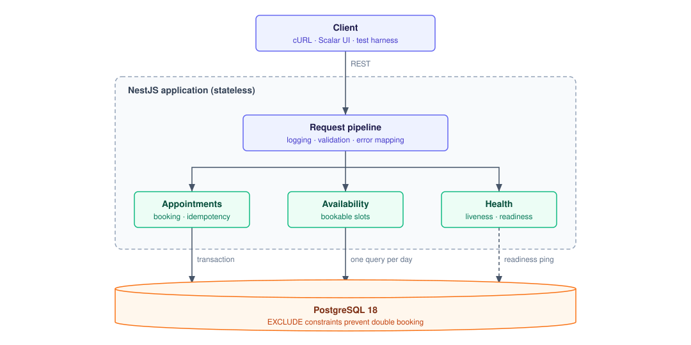
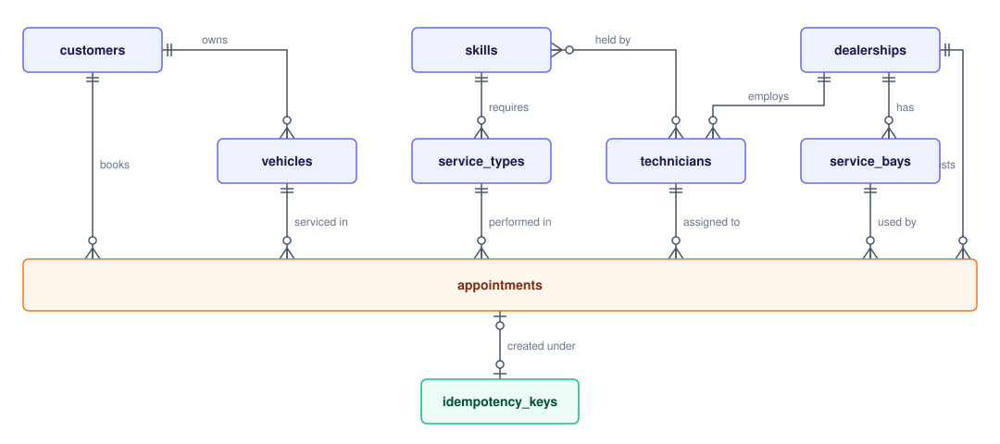

# Unified Service Scheduler: System Design

How the system meets the requirements in [`SPEC.md`](SPEC.md), and why it is built this way.
Assumptions (A1 to A12) are defined in `SPEC.md` and referenced here by ID.

**Stack:** NestJS 12 (TypeScript, ESM) on Node.js 24 LTS, TypeORM, PostgreSQL 18, pino, Docker Compose. Tooling: Vitest, Testcontainers, oxlint, Prettier. API reference: Scalar.

---

## 1. Architecture

A single NestJS application organized in feature modules. PostgreSQL is the only backing service and the single source of truth for correctness. The application is stateless, so more instances can run behind a load balancer without changing the design.

### Architecture diagram



Every request passes the pipeline, then one feature module. PostgreSQL is the only backing service: its `EXCLUDE` constraints, not application checks, prevent double booking. Each module is described under Components; the booking steps are in Booking Flow; endpoints are in `SPEC.md` (REST API).

### Components

| Component               | Role                                                                                                                                                                         |
| ----------------------- | ---------------------------------------------------------------------------------------------------------------------------------------------------------------------------- |
| `AppointmentsModule`    | `POST /appointments` and `GET /appointments/:id`. The service runs the booking transaction: idempotency claim, validation, allocation, guarded insert.                       |
| `AvailabilityModule`    | `GET /availability`. Computes bookable slots with free resource counts in one query per day.                                                                                 |
| `BookingPolicyService`  | Provider in `AppointmentsModule`, exported for availability. When an appointment may start and end: start time (A5) and opening hours (A4), both in the dealership timezone. |
| `CandidateAllocator`    | Plain class created per booking. Walks technician and bay pairs in a deterministic order and skips resources lost to a concurrent booking.                                   |
| `common/`               | Typed errors (`AppError` subclasses, one per error catalog code), the exception filter, and time utilities (`TimeRange`, zoned-time helpers on the standard `Intl` API).     |
| `DatabaseModule`        | TypeORM connection, entities, plain SQL migrations, demo seed data.                                                                                                          |
| `LoggerModule`          | Structured JSON logs with a correlation id per request.                                                                                                                      |
| `GlobalExceptionFilter` | Maps typed errors to HTTP codes using the error catalog in `SPEC.md`, and writes the unified error body.                                                                     |
| `HealthModule`          | Liveness and readiness probes.                                                                                                                                               |

Rules:

- Controllers are thin: validate input, call one service method, shape the response.
- Services own their transactions (`DataSource.transaction`). SQL that depends on PostgreSQL features (ranges, exclusion constraints, savepoints) is written as plain SQL inside the service.
- Business rules live in injectable services of their module; time arithmetic lives in `common/time/`. Neither touches the database, so both are unit tested without one.
- Errors are thrown as typed errors from `common/errors.ts` and mapped to HTTP codes in one place, `GlobalExceptionFilter`.

### Technology choices

| Technology                                               | Role                                                      | Why                                                                                                                                    |
| -------------------------------------------------------- | --------------------------------------------------------- | -------------------------------------------------------------------------------------------------------------------------------------- |
| NestJS 12, TypeScript (strict, ESM)                      | HTTP framework, dependency injection, validation, OpenAPI | Modules, providers and DTOs give a conventional structure reviewers recognize; decorators generate the OpenAPI contract from the code. |
| PostgreSQL 18                                            | System of record                                          | `tstzrange`, `EXCLUDE USING gist` and savepoints let the database itself reject double bookings under any concurrency.                 |
| TypeORM                                                  | Connection, migrations runner, entity reads               | Integrates with NestJS; raw SQL is used where PostgreSQL features matter, and migrations are plain SQL.                                |
| pino (`nestjs-pino`)                                     | Structured JSON logging                                   | Low overhead, one JSON line per event, request context carried automatically.                                                          |
| Vitest, Testcontainers, supertest                        | Unit, integration and HTTP tests                          | Integration and concurrency tests run against a real PostgreSQL 18, the only way to test constraints, locks and savepoints.            |
| Docker Compose                                           | Local runtime                                             | One command starts the application and PostgreSQL; nothing is installed on the host.                                                   |
| Scalar                                                   | API reference at `/docs`                                  | Interactive client for the OpenAPI document, which stands in for the frontend.                                                         |
| oxlint (type-aware), Prettier, Conventional Commits hook | Code quality                                              | Catches floating promises, `any` and `console`; consistent formatting and history.                                                     |

---

## 2. Booking Flow (`AppointmentsService.create`)

1. The controller validates the DTO and the mandatory `Idempotency-Key` header, then calls the service.
2. The service runs everything inside one `DataSource.transaction`.
3. `IdempotencyService` claims the key with `INSERT ... ON CONFLICT DO NOTHING` on `idempotency_keys`, storing a SHA-256 hash of the request payload (start normalized to UTC). If another transaction holds the same key, PostgreSQL blocks the insert until that transaction ends. Then:
   - New key: the booking proceeds.
   - Unexpired key, same hash: the stored appointment is replayed (`200`, `Idempotent-Replayed: true`).
   - Unexpired key, different hash: `IDEMPOTENCY_KEY_REUSED`.
   - Expired key: overwritten and treated as new (A12).
4. The dealership, service type and vehicle are loaded; the vehicle's owner becomes the appointment's customer (A8). `BookingPolicyService` validates: start in the future, slot alignment, opening hours in the dealership timezone.
5. A transaction-level advisory lock on (dealership, local day) is taken, so overlapping bookings at one dealership queue instead of deadlocking on each other's uncommitted rows. Then the vehicle is checked (A7) and one query lists candidate technicians (qualified, active) and bays (active), excluding those busy in `[start, end)`. `CandidateAllocator` walks the pairs in a deterministic order (sorted by id).
6. Each pair is inserted inside a **SAVEPOINT**, so a failed insert undoes only that attempt; in PostgreSQL a failed statement otherwise aborts the whole transaction. At most 20 attempts. If the insert fails:
   - Exclusion violation (`23P01`) on a technician or bay: that technician or bay is skipped in all remaining pairs.
   - Exclusion violation on the vehicle: the request ends with `VEHICLE_ALREADY_BOOKED`.
   - Deadlock (`40P01`), possible only when one vehicle is booked at two dealerships at once: the same pair is retried, at most three times.
7. No pair succeeds: `SLOT_UNAVAILABLE`. No qualified technician exists at the dealership: `NO_QUALIFIED_TECHNICIAN`.
8. The result is stored for idempotent replay, the transaction commits, and `201` is returned. Booking events are logged as structured events.

Any failure rolls back the transaction, including the idempotency row, which is how A11 holds.

---

## 3. Data Model (PostgreSQL)

Enable `btree_gist`. Use plain SQL migrations (`src/database/migrations/`, applied on startup). Use `uuid` primary keys and `timestamptz` (UTC). TypeORM entities in `src/database/entities/` map the tables for reads; they do not map `time_range` and never generate schema.



Columns and constraints of each table:

| Table               | Key columns                                                                                                                                              | Constraints                                                                                                  |
| ------------------- | -------------------------------------------------------------------------------------------------------------------------------------------------------- | ------------------------------------------------------------------------------------------------------------ |
| `dealerships`       | id, name, timezone, open_time, close_time                                                                                                                |                                                                                                              |
| `customers`         | id, name, email, phone                                                                                                                                   | unique email                                                                                                 |
| `vehicles`          | id, customer_id, vin, make, model, year                                                                                                                  | unique vin; FK customer                                                                                      |
| `skills`            | id, code, name                                                                                                                                           | unique code                                                                                                  |
| `service_types`     | id, code, name, duration_minutes, required_skill_id                                                                                                      | duration > 0; FK skill                                                                                       |
| `technicians`       | id, dealership_id, name, is_active                                                                                                                       | FK dealership                                                                                                |
| `technician_skills` | technician_id, skill_id                                                                                                                                  | PK (technician_id, skill_id)                                                                                 |
| `service_bays`      | id, dealership_id, name, is_active                                                                                                                       | FK dealership                                                                                                |
| `appointments`      | id, customer_id, vehicle_id, dealership_id, service_type_id, technician_id, service_bay_id, start_at, end_at, time_range, status, created_at, updated_at | see below                                                                                                    |
| `idempotency_keys`  | key (PK), request_hash, appointment_id, created_at, expires_at                                                                                           | `expires_at = created_at + 24 hours` (A12); a replay re-reads the appointment, so no response body is stored |

`appointments.status` is `CONFIRMED` or `CANCELLED`. Only `CONFIRMED` is written today; `CANCELLED` is reserved for a future cancellation feature (A9), and the exclusion constraints already ignore it.

Core constraints (the authoritative protection against double booking):

```sql
CHECK (end_at > start_at)
time_range tstzrange GENERATED ALWAYS AS (tstzrange(start_at, end_at, '[)')) STORED

EXCLUDE USING gist (technician_id  WITH =, time_range WITH &&) WHERE (status = 'CONFIRMED')
EXCLUDE USING gist (service_bay_id WITH =, time_range WITH &&) WHERE (status = 'CONFIRMED')
EXCLUDE USING gist (vehicle_id     WITH =, time_range WITH &&) WHERE (status = 'CONFIRMED')
```

Indexes: `appointments(dealership_id, start_at)` for availability queries; the three exclusion constraints create GiST indexes that also serve overlap lookups by technician, bay and vehicle.

Constraint names (`appointments_technician_no_overlap`, `appointments_service_bay_no_overlap`, `appointments_vehicle_no_overlap`) are part of the contract: the booking service reads them from `23P01` errors to tell which resource was taken.

**Seed data (A10):** `src/database/seed.ts` inserts demo reference data with fixed ids when `DB_SEED=true`, ignoring rows that already exist. It contains a main dealership (three technicians, one inactive technician, three bays) and an express dealership with one technician and one bay for the race-condition demo, plus twenty fleet vehicles so parallel demo requests contend for resources, not for the same vehicle.

---

## 4. Availability

`AvailabilityService` answers `GET /availability`:

1. The dealership and service type are loaded (`404` if unknown). `BookingPolicyService.slotStarts` lists every start on the local day that satisfies A4 and A5; starts in the past are dropped.
2. One SQL query (`unnest ... WITH ORDINALITY`) counts, for every start, the free qualified technicians and the free bays. Starts with at least one of each are returned with both counts. Any free qualified technician can pair with any free bay, so the counts are independent.

Availability is advisory: it reserves nothing, and `POST /appointments` re-checks every resource inside its transaction. A start shown as free can therefore still return `409` if another booking takes it first. Availability is not cached; see Key Decisions.

---

## 5. Observability

**Logging.** Structured JSON through pino (`nestjs-pino`), one line per event, level set by `LOG_LEVEL`.

- Every request gets a correlation id: the `X-Correlation-Id` request header, or a generated UUID. It is echoed in the response header, attached to every log line of the request, and included in every error body, so a client report leads straight to the server logs.
- Each request is logged on completion with method, URL, status and `responseTime` in milliseconds. Headers and bodies are not logged.
- Domain events: `booking_created` (appointment, technician, bay, attempts), `booking_conflict` (reason: technician, serviceBay, vehicle or no_free_pair), `booking_deadlock_retry`, `idempotent_replay`, `request_rejected` (error code and status), `unhandled_error` (with the stack, never returned to the client).

**Health.** `GET /health/live` (process up) and `GET /health/ready` (PostgreSQL reachable).

**Metrics and tracing (future extension, out of scope).** The log events above are designed to become metrics without code changes in the hot path: booking outcomes by reason, booking latency, attempts per booking, deadlock retries. The next steps would be a Prometheus endpoint (`@willsoto/nestjs-prometheus`) and OpenTelemetry tracing with the correlation id as the trace attribute, exported to the same backend as the logs.

---

## 6. Testing Strategy

The test cases themselves are listed in `SPEC.md` (Acceptance Tests). This section defines how they are run.

- **Unit** tests cover the pure rules, with no database:
  - `BookingPolicyService`: start in the future and on a slot boundary (A5); opening hours, Sunday and midnight in the dealership timezone (A4); the slot starts offered by availability.
  - `CandidateAllocator`: deterministic pair order, skipping a taken technician or bay, and the attempt limit.
  - Time utilities in `common/time/`: half-open range overlap (A3) and timezone conversion, including daylight saving.
- Service behavior is covered by integration tests through HTTP against real PostgreSQL, because its correctness depends on constraints, transactions and savepoints that fakes cannot reproduce.
- **Integration and concurrency** tests run against a real PostgreSQL instance through Testcontainers. SQLite or an in-memory database is never a substitute.
- Tests run inside the `app` container, so Testcontainers needs the host Docker daemon: mount `/var/run/docker.sock` into the `app` service and set `TESTCONTAINERS_HOST_OVERRIDE=host.docker.internal`.
- Test files are named by suite: unit tests sit next to their source as `src/**/*.spec.ts` (`npm run test`), as in a default NestJS project; `test/integration/**/*.int-spec.ts` (`npm run test:integration`), `test/e2e/**/*.e2e-spec.ts` (`npm run test:e2e`).
- **Regression evidence:** a naive check-then-insert booking function exists only as a test double under `test/integration/support/`, never in `src/`. The concurrency suite runs against it to show that it double books under load while the constraint-based implementation does not.
- **Static checks:** oxlint with type-aware rules (`no-floating-promises`, `no-explicit-any`, `no-console`) and Prettier.

---

## 7. Key Decisions

| Decision                                                                     | Alternatives considered                                                                                 | Why                                                                                                                                                                                                                                                                                                                          |
| ---------------------------------------------------------------------------- | ------------------------------------------------------------------------------------------------------- | ---------------------------------------------------------------------------------------------------------------------------------------------------------------------------------------------------------------------------------------------------------------------------------------------------------------------------- |
| Prevent double booking with PostgreSQL `EXCLUDE` constraints on `tstzrange`  | Check-then-insert in application code; `SELECT ... FOR UPDATE` on resource rows; Redis distributed lock | The database rejects every overlapping write regardless of code path or number of app instances. Check-then-insert races; row locks do not cover rows that do not exist yet; a Redis lock adds a failure point outside the transaction.                                                                                      |
| Try candidate pairs inside a `SAVEPOINT` and retry on `23P01`                | Fail on the first conflict; restart the whole transaction                                               | A conflict on one pair should not fail the request when another pair is free. Without a savepoint, a failed statement aborts the whole transaction.                                                                                                                                                                          |
| Advisory lock per dealership and local day before allocation                 | No lock, retry on deadlock only; lock rows of all candidate resources; `SERIALIZABLE` isolation         | Concurrency tests showed that parallel inserts on the same bay or vehicle deadlock on each other's uncommitted rows; retries alone took up to a minute under load. The lock orders contenders for one dealership-day only, keeps other days and dealerships parallel, and leaves the exclusion constraints as the guarantee. |
| Store idempotency keys in PostgreSQL, in the same transaction as the booking | Redis with `SET NX`; in-memory map                                                                      | Key and appointment commit or roll back together (A11). The unique key serializes concurrent duplicates without extra locking.                                                                                                                                                                                               |
| No cache for `GET /availability`                                             | Redis read-through cache with a short TTL                                                               | The brief does not require a cache, and availability is one indexed query per day. A cache adds a service to run and a staleness window; it can be added if measured load calls for it.                                                                                                                                      |
| Plain SQL migrations                                                         | ORM-generated migrations or `synchronize`                                                               | Exclusion constraints, generated columns and `btree_gist` cannot be expressed through ORM decorators.                                                                                                                                                                                                                        |
| Assign technician and bay automatically (A1)                                 | Let the user choose                                                                                     | Matches the requirement of a single booking request, and keeps allocation inside one transaction.                                                                                                                                                                                                                            |
| Standard NestJS feature modules; business rules in injectable services       | Clean Architecture with ports, adapters and framework-free use cases                                    | Default NestJS structure is easier to read and review at this size. Logic that depends on PostgreSQL is tested against PostgreSQL instead of fakes.                                                                                                                                                                          |

---

## 8. Scalability, Performance and Reliability

- **Horizontal scaling.** The application holds no state. Correctness lives in PostgreSQL constraints and transaction-scoped advisory locks, which hold across any number of instances.
- **Contention.** Bookings queue only per dealership and local day; different days and dealerships proceed in parallel. Each booking holds the lock for a few short queries. Twenty parallel requests for one slot complete in well under a second in the demo.
- **Reads.** Availability is one SQL query per day, served by the GiST and `start_at` indexes. If reads come to dominate, a read replica or a short-TTL cache could serve it, since it is advisory.
- **Indexes.** The exclusion constraints create GiST indexes that serve every overlap lookup by technician, bay and vehicle; `appointments(dealership_id, start_at)` serves day scans.
- **Reliability.** PostgreSQL is the only dependency, so readiness reflects exactly what the service needs. A failed booking leaves no trace, including its idempotency key, so clients can retry safely. Deadlocks that remain possible across dealerships are retried a bounded number of times.
- **Growth.** `appointments` can be partitioned by `start_at` range when history grows; expired idempotency keys are overwritten on reuse today, and a periodic `DELETE ... WHERE expires_at < now()` job would bound the table.
- **Not covered:** authentication, rate limiting, multi-region deployment and load testing (see `SPEC.md`, Scope).

---

## 9. GenAI Usage

The owner used Claude Code (Anthropic) as an implementation agent and kept design authority. The full record is in [`ai-log.md`](ai-log.md); the README summarizes the collaboration.

**Design phase.**

- The owner gave the agent the assessment brief ([`ASSESSMENT.md`](ASSESSMENT.md)) and asked for a specification first. The agent drafted requirements, assumptions A1 to A12, the REST API and the error catalog; the owner reviewed them before any code was written.
- The owner set the main design decisions: an idempotency key on `POST /appointments` to make duplicate submissions and client retries safe, and no state outside PostgreSQL.
- The agent proposed alternatives for double-booking prevention (check-then-insert, row locks, a Redis lock, exclusion constraints) with trade-offs; the decision table in Key Decisions is the outcome.
- The agent's first architecture was Clean Architecture with ports and in-memory fakes. The owner rejected it as harder to follow than the problem needs and directed the standard NestJS structure. The owner also removed the fakes: the system's correctness lives in exclusion constraints, savepoints and locks, which a hand-written fake cannot reproduce, so database behavior is tested against real PostgreSQL. These tests later exposed the booking deadlock.

**Guard rails.** `AGENTS.md` gives every session the same rules: read the plan first, one step at a time with a checkpoint, tests before code, PostgreSQL constraints for correctness, no features outside the specification.

**Verification.** Every behavior was specified by a failing test before the code existed. Integration and concurrency tests run against real PostgreSQL. The concurrency suite caught a deadlock the agent had not anticipated; its first fix was rejected after repeated runs, and the advisory lock replaced it. Each step was also run on the Compose stack, and the owner reviewed the commit history and the code after each step.
