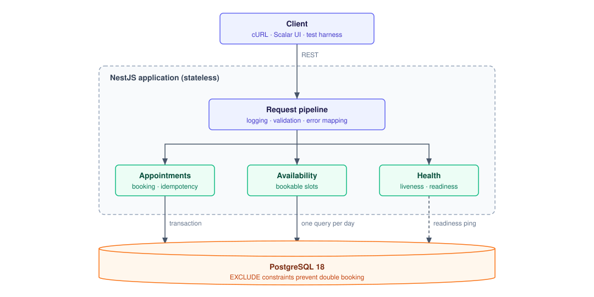
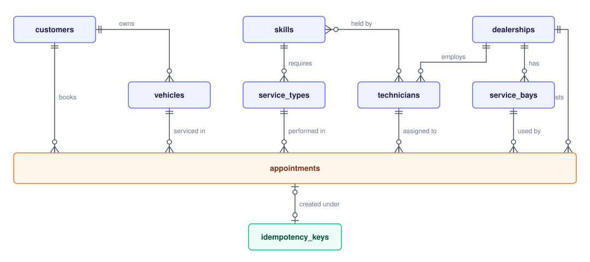
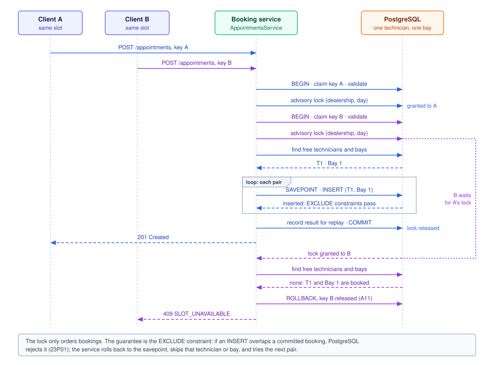

<!--
Standalone System Design Document for the Keyloop submission.
Compiled from docs/SPEC.md and docs/SYSTEM_DESIGN.md, which remain the sources of truth.
When either changes, update this file and export the PDF again.
-->

# Unified Service Scheduler: System Design Document

<div class="toc" markdown="1">

**Contents**

- [1. Problem Definition](#1-problem-definition)
  - [1.1 Requirements](#11-requirements)
  - [1.2 Scope](#12-scope)
  - [1.3 Assumptions](#13-assumptions)
- [2. Architecture](#2-architecture)
  - [2.1 Components](#21-components)
  - [2.2 Technology Choices](#22-technology-choices)
- [3. API Contract](#3-api-contract)
  - [3.1 Endpoints](#31-endpoints)
  - [3.2 Error Model](#32-error-model)
- [4. Data Design](#4-data-design)
  - [4.1 Data Model](#41-data-model)
  - [4.2 Double-Booking Guarantee](#42-double-booking-guarantee)
- [5. Data Flow](#5-data-flow)
  - [5.1 Booking](#51-booking)
  - [5.2 Availability](#52-availability)
- [6. Key Decisions](#6-key-decisions)
- [7. Quality Attributes](#7-quality-attributes)
  - [7.1 Observability](#71-observability)
  - [7.2 Scalability, Performance and Reliability](#72-scalability-performance-and-reliability)
  - [7.3 Maintainability and Testing](#73-maintainability-and-testing)
- [8. GenAI Usage](#8-genai-usage)
  - [8.1 Design Phase](#81-design-phase)
  - [8.2 Verification](#82-verification)

| Assessment        | Keyloop Technical Assessment, Scenario A                  |
| ----------------- | --------------------------------------------------------- |
| Layer implemented | Backend: RESTful API with a PostgreSQL database           |
| Repository        | <https://github.com/ndmanh3003/unified-service-scheduler> |

</div>

---

## 1. Problem Definition

### 1.1 Requirements

The scheduler replaces manual service booking at dealerships. The brief sets three core requirements:

1. **Resource-constrained booking.** A user requests a service appointment for a vehicle, a service type and a dealership at a desired time.
2. **Real-time availability check.** Before confirming, both a service bay and a qualified technician must be free for the whole service duration.
3. **Confirmed appointment record.** On success, a persistent appointment links the customer, the vehicle, the technician and the service bay.

Quality goals derived from the domain:

- No double booking under any concurrency, across any number of application instances.
- Every partial time-range overlap is detected.
- Duplicate submissions and client retries never create a second appointment.
- Errors are precise and consistent.

### 1.2 Scope

- **In scope:** the backend layer: a RESTful API and a PostgreSQL database. The client is stubbed with cURL examples, an OpenAPI reference and an automated test harness.
- **Out of scope:** authentication, cancellation and rescheduling, appointment search, CRUD for reference data, rate limiting, metrics export, load testing, notifications, payments, user interface.

### 1.3 Assumptions

The brief leaves several points open. Each is resolved by an assumption, referenced by ID in the rest of this document.

| ID  | Assumption                                                                                                                                   |
| --- | -------------------------------------------------------------------------------------------------------------------------------------------- |
| A1  | The system assigns the technician and the service bay automatically. The user does not choose them.                                          |
| A2  | Each service type has a fixed duration and exactly one required skill. A technician is qualified if they hold that skill.                    |
| A3  | Time ranges are half-open, `[start, end)`. An appointment ending at 10:00 does not conflict with one starting at 10:00.                      |
| A4  | A service must fit within the dealership's opening hours, in the dealership's timezone, Monday to Saturday, and must not span multiple days. |
| A5  | The start time must be in the future and aligned to a 15-minute slot (configurable).                                                         |
| A6  | No buffer between appointments; back-to-back bookings are allowed.                                                                           |
| A7  | A vehicle cannot hold two overlapping confirmed appointments.                                                                                |
| A8  | The request names only the vehicle, service type, dealership and time, as the brief does; the appointment's customer is the vehicle's owner. |
| A9  | Appointments are created as `CONFIRMED`; a status column leaves room for cancellation without a schema change.                               |
| A10 | Reference data (dealerships, bays, technicians, skills, service types, customers, vehicles) is seeded.                                       |
| A11 | Only successful bookings are stored for idempotent replay; a failed attempt is evaluated again when retried.                                 |
| A12 | An idempotency key is retained for 24 hours, then treated as new.                                                                            |

---

## 2. Architecture



One stateless NestJS application in front of PostgreSQL. PostgreSQL is the only backing service and the single source of truth for correctness.

### 2.1 Components

- **Client (stub):** cURL examples, the interactive OpenAPI reference and the test harness, in place of a frontend.
- **Request pipeline:** applied to every request.
  - Assigns a correlation id and writes structured logs.
  - Validates input against DTOs.
  - Maps every error to one response shape (`GlobalExceptionFilter`).
- **Feature modules:**
  - **Appointments:** books and reads appointments.
    - `BookingPolicyService`: when an appointment may start and end (A4, A5).
    - `CandidateAllocator`: picks the next free technician and bay pair.
    - `IdempotencyService`: claims the `Idempotency-Key` and replays repeated requests.
  - **Availability:** lists bookable starts for a day.
  - **Health:** liveness and readiness probes.
- **PostgreSQL:** stores all data and enforces the no-overlap rule with exclusion constraints.

### 2.2 Technology Choices

- **NestJS (TypeScript, strict):** modules, dependency injection and DTO validation give a conventional, reviewable structure; the OpenAPI contract is generated from the code.
- **PostgreSQL:** `tstzrange` and `EXCLUDE` constraints let the database itself reject overlapping bookings; transactions and savepoints make allocation atomic.
- **TypeORM with plain SQL migrations:** standard NestJS integration for reads; plain SQL for the constraints an ORM cannot express.
- **pino:** structured JSON logs with request context, at low overhead.
- **Vitest with Testcontainers:** integration and concurrency tests run against a real PostgreSQL, the only way to test constraints, locks and savepoints.

---

## 3. API Contract

### 3.1 Endpoints

All business endpoints are under `/api/v1`.

- **`POST /appointments`:** books an appointment.
  - Body: `vehicleId`, `serviceTypeId`, `dealershipId`, `startAt` (ISO 8601 with offset).
  - Header `Idempotency-Key` (UUID) is mandatory.
  - `201` with the appointment, including the assigned technician and bay.
  - `200` with `Idempotent-Replayed: true` when the same key and payload are sent again.
- **`GET /appointments/:id`:** the appointment with its customer, vehicle, dealership, service type, technician and bay.
- **`GET /availability?dealershipId=&serviceTypeId=&date=`:** bookable starts for a day, with free technician and bay counts. Not required by the brief; it lets a client find a slot before booking.
- **Operational:** `GET /health/live`, `GET /health/ready`, and the API reference at `GET /docs`.

### 3.2 Error Model

- Every error has one shape: `{ "error": { "code", "message", "correlationId" } }`. The correlation id links a client report to the server logs.
- Status codes group errors by cause:

| HTTP | Meaning                                          | Codes                                                                                                                                                                                                        |
| ---- | ------------------------------------------------ | ------------------------------------------------------------------------------------------------------------------------------------------------------------------------------------------------------------ |
| 400  | Malformed request                                | `VALIDATION_FAILED`<br>`IDEMPOTENCY_KEY_REQUIRED`                                                                                                                                                            |
| 404  | Unknown resource or route                        | `NOT_FOUND`                                                                                                                                                                                                  |
| 409  | Conflicts with current bookings                  | `SLOT_UNAVAILABLE` (no free technician and bay pair)<br>`VEHICLE_ALREADY_BOOKED` (A7)                                                                                                                        |
| 422  | Well-formed, but breaks a business rule          | `OUTSIDE_BUSINESS_HOURS` (A4)<br>`START_IN_PAST` (A5)<br>`INVALID_SLOT_ALIGNMENT` (A5)<br>`NO_QUALIFIED_TECHNICIAN` (no active skilled technician)<br>`IDEMPOTENCY_KEY_REUSED` (same key, different payload) |
| 500  | Unexpected failure; details logged, not returned | `INTERNAL_ERROR`                                                                                                                                                                                             |

---

## 4. Data Design

### 4.1 Data Model



- **Reference data (seeded, A10):** dealerships with timezone and opening hours, technicians and their skills, service bays, service types with duration and required skill, customers and their vehicles.
- **Booking data:**
  - `appointments`: links customer, vehicle, dealership, service type, technician and bay, with `start_at`, `end_at` and `status`.
  - `idempotency_keys`: key, payload hash, appointment id and expiry (A12).

### 4.2 Double-Booking Guarantee

```sql
time_range tstzrange GENERATED ALWAYS AS (tstzrange(start_at, end_at, '[)')) STORED

EXCLUDE USING gist (technician_id  WITH =, time_range WITH &&) WHERE (status = 'CONFIRMED')
EXCLUDE USING gist (service_bay_id WITH =, time_range WITH &&) WHERE (status = 'CONFIRMED')
EXCLUDE USING gist (vehicle_id     WITH =, time_range WITH &&) WHERE (status = 'CONFIRMED')
```

- The half-open range implements A3; `&&` catches every partial overlap.
- The database rejects an overlapping insert whatever the code path or number of instances.
- Each constraint has a fixed name, so the service knows which resource was taken.
- `CANCELLED` rows are ignored, so cancellation (A9) needs no schema change.

---

## 5. Data Flow

### 5.1 Booking



Everything below runs in one database transaction.

1. **Idempotency claim.** Insert the key with a hash of the payload.
   - New key: continue.
   - Same key, same payload: return the stored appointment (`200`).
   - Same key, different payload: `IDEMPOTENCY_KEY_REUSED`.
   - Same key in flight: PostgreSQL blocks until the first request ends.
2. **Validation.** Load the vehicle, service type and dealership; the customer is the vehicle's owner (A8). Check A4 and A5, and that a qualified technician exists (`NO_QUALIFIED_TECHNICIAN`).
3. **Ordering.** Take an advisory lock on (dealership, local day), so concurrent bookings for that day queue instead of deadlocking.
4. **Allocation.** Reject the request if the vehicle already has an overlapping booking (A7). List free qualified technicians and free bays, then try each pair inside a `SAVEPOINT`:
   - Insert succeeds: done.
   - Technician or bay taken by a concurrent booking: skip it and try the next pair.
   - Vehicle taken: `VEHICLE_ALREADY_BOOKED`.
   - No pair left: `SLOT_UNAVAILABLE`.
5. **Commit** and return `201`.

Any failure rolls back the whole transaction, including the idempotency key (A11), so a client can always retry safely.

### 5.2 Availability

1. Generate every start on the local day that satisfies A4 and A5.
2. Count free qualified technicians and free bays for each start in one SQL query.
3. Return starts with at least one of each.

Availability is advisory: it reserves nothing, and booking re-checks everything in its transaction.

---

## 6. Key Decisions

- **Exclusion constraints, not application checks, prevent double booking.**
  - Check-then-insert races under concurrency.
  - Row locks cannot lock a booking that does not exist yet.
  - A Redis lock adds a service and a failure point outside the transaction.
- **Each candidate pair is tried inside a savepoint.**
  - A conflict on one pair must not fail the request while another pair is free.
  - Without a savepoint, one failed statement aborts the whole transaction.
- **An advisory lock per dealership and day orders concurrent bookings.**
  - Concurrency tests showed parallel inserts deadlocking; retries alone were too slow.
  - Only one dealership-day is serialized; other days and dealerships stay parallel.
  - The constraints remain the guarantee; the lock only removes deadlocks.
- **Idempotency keys live in PostgreSQL, in the booking transaction.**
  - Key and appointment commit or roll back together.
  - The unique key serializes duplicate requests without extra locking.
- **Technician and bay are assigned automatically (A1).**
  - The brief's request carries no technician or bay.
  - Allocation stays inside one transaction.
- **No cache for availability.** One indexed query per day is fast enough; a cache adds a service and stale results.
- **Standard NestJS modules instead of a layered architecture.**
  - Easier to read and review at this size.
  - Database-dependent logic is tested against PostgreSQL, not fakes.

---

## 7. Quality Attributes

### 7.1 Observability

- **Correlation id** on every request: taken from `X-Correlation-Id` or generated, returned in the response, attached to every log line and every error body.
- **Structured JSON logs:** one line per request with status and latency; no headers or bodies.
- **Domain events:** `booking_created`, `booking_conflict` (with reason), `booking_deadlock_retry`, `idempotent_replay`, `request_rejected`, `unhandled_error`.
- **Health probes:** liveness, and readiness that checks PostgreSQL.
- **Next steps:** turn the domain events into Prometheus metrics (outcomes, latency, retries) and add OpenTelemetry tracing keyed by the correlation id.

### 7.2 Scalability, Performance and Reliability

- **Horizontal scaling:** the application is stateless; constraints and locks live in PostgreSQL and hold across instances.
- **Contention:** bookings queue only per dealership-day; twenty parallel requests for one slot complete in under a second.
- **Reads:** availability is one indexed query; a read replica or cache can be added if load requires.
- **Growth:** `appointments` can be partitioned by time; expired idempotency keys can be purged by a scheduled job.
- **Single dependency:** PostgreSQL is the only backing service, so readiness reflects exactly what the service needs.
- **Safe retries:** a failed booking leaves no trace; remaining cross-dealership deadlocks are retried a bounded number of times.

### 7.3 Maintainability and Testing

- Standard NestJS structure; typed errors mapped to HTTP in one place; TypeScript strict mode and type-aware linting.
- **Unit tests:** opening hours, slot rules and time zones; candidate ordering; range overlap.
- **Integration tests on real PostgreSQL:** constraints, partial and adjacent overlaps, every error case, idempotency.
- **Concurrency tests:**
  - 20 parallel requests for one technician and one bay: one `201`, nineteen `409`, one row.
  - 10 parallel requests for three of each: exactly three succeed.
  - A naive check-then-insert version double books under the same load, as regression evidence.

---

## 8. GenAI Usage

Claude Code was the implementation agent; I kept design authority and the final say on every step.

### 8.1 Design Phase

- I had the agent turn the brief into a specification first: requirements, assumptions A1 to A12, API, error catalog, acceptance tests. I reviewed it before any code.
- I made the main calls: a mandatory idempotency key, and PostgreSQL as the only backing service.
- The agent compared options for double-booking prevention; the outcome is in Key Decisions.
- I rejected the agent's first architecture (Clean Architecture with in-memory fakes) as too complex, and required database behavior to be tested against real PostgreSQL.
- One instruction file gives every agent session the same guard rails: read the plan first, one step at a time with a human checkpoint, tests before code, PostgreSQL constraints for correctness, nothing outside the specification.

### 8.2 Verification

- Every behavior started as a failing test; the history shows a `test:` commit before each `feat:` commit.
- After each step I ran the stack: cURL calls, the race-condition demo, the logs.
- Where the agent was wrong:
  - **Over-engineered architecture:** caught in code review; rebuilt as standard NestJS modules.
  - **Deadlocks under parallel bookings (`500`):** caught by concurrency tests; the agent's first fix failed repeated runs and was replaced by the advisory lock.
